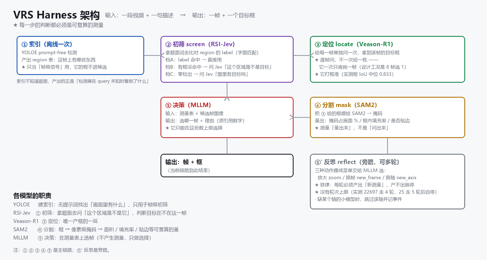

# VeasonHarness

**给 LLM agent 的一双眼睛**：喂它一段视频和一句话（"那只爬上去又滑下来的熊猫"），
它告诉你**这件事发生在第几帧、目标在画面哪个位置**。

名字由来：`Veason` 是这套流程里做定位的那只模型（Veason-R1），`Harness` 是它外面的那圈
脚手架 —— 模型负责"看"，脚手架负责"别让它瞎看"。**两者分开才是这个项目的重点**：
模型换掉、脚手架不动；脚手架改口径、模型不用重训。

```
视频 ──► 建索引(一次) ──► 五环链(每个问题跑一遍) ──► 一个框

        YOLOE 无提示词              ① screen   初筛出少数候选帧
        理解画面的分区             ② locate   在候选帧上做精细定位
                                  ③ evidence 从不同角度取证
                                  ④ decide   选一帧、选一个区域
                                  ⑤ reflect  没新发现就停
```

**它不做理解。** 理解交给外面的 agent；这里只做**确定性计算 + 可审计的中间产物**。

---

## 实测跑分

在同一批候选帧、同一把尺子（真值掩码面积排名）下对比：

```
                     平均归一化名次     说明
Veason-R1 本体          0.615          ★ 它在每一题都选 f0 —— 不做选择
脚手架 + Veason-R1      0.385          好于随机
随机策略                0.500
```

**归一化名次 = 名次 ÷ 总帧数**（越低越好）。逐题：

```
题目                        总帧   Veason 本体       本脚手架
① 灵长类（the primate.）      9    f0 (8/9 = 0.889)   f6  (1/9 = 0.111)
② 跑→跳→两滚→停在垫上        16    f0 (14/16=0.875)   f16 (13/16=0.812)
③ 背对镜头的黑熊             16    f0 (6/16 = 0.375)  f80 (1/16 = 0.062)
④ 唯一的那个人               16    f0 (9/16 = 0.562)  f44 (5/16 = 0.312)
⑤ 属大熊猫科的动物           16    f0 (6/16 = 0.375)  f107(10/16=0.625)
```

**一句话结论**：Veason-R1 **打框准**（实测框 IoU 中位 0.833、最好一题 0.982），
但**它不选帧** —— 它把"选哪一帧"这件事固定成了"取排在最前面的那个"。
所以这套脚手架价值不在"用了更强的模型"，而在**把它不擅长的那件事从它手里拿走**。

> ⚠️ 这里用的是 ReVOS **ground** 训练集里挑出来的 5 道难例，**不代表整体精度**。
> ⑤ 是唯一的**多实例**题（题面是复数、真值按 4 只面积之和计），与其余四题不同尺，
> 该项对比仅供参考。

---


## 架构设计




### 一、分成两层：脚手架 + 模型

```
┌─────────────────────────── 脚手架（确定性，可测） ───────────────────────────┐
│                                                                             │
│   vrs_pipeline.py   编排：在【哪些点】需要 agent 做决定，显式写出来           │
│   vrs_skills/cli.py 装配点：唯一的依赖注入处                              │
│                                                                             │
│   ① screen   ─ ② locate ─ ③ evidence ─ ④ decide ─ ⑤ reflect                 │
│                                                                             │
│   索引层  store.py / video.py / paths.py   区域表只追加、不重排                │
│   契约层  errors.py                        stdout 一个 JSON，stderr 一个 JSON  │
└─────────────────────────────────────────────────────────────────────────────┘
                                    ▲
                                    │ 只通过 CLI 契约接触（可替换）
                                    ▼
┌─────────────────────────── 模型 ─────────────────────────────────────────────┐
│  YOLOE 11s-seg      无提示词建索引（只当帧级信号）                              │
│  RSI-Jev (v6.1-VL)  ① 初筛：问"这个区域是不是题面说的那个"                      │
│  Veason-R1 (3B)     ② 定位：唯一产框的一环                                     │
│  SAM2               ③ 框 → 掩码 → 面积/填充率/贴边                             │
│  CLIP / depth / pose / relation   其余证据轴                                  │
└─────────────────────────────────────────────────────────────────────────────┘
```

### 二、五环：每一环的输入输出都是落盘的 JSON

| 环 | 干什么 | 为什么单列一环 |
|---|---|---|
| ⓪ rewrite | agent 把自然语言问题改写成外观名词短语 | 检测器只认外观、不认关系（YOLOE 官方原话：*a prompt describes appearance, not relationships*）。**这一步缺了就直接停**，不静默跑成"零命中" |
| ① screen | 从全部帧里初筛出少数候选 | 后面每一环都贵，先砍数量 |
| ② locate | 在候选帧上做精细定位 | **唯一产框的一环** |
| ③ evidence | 从深度/关系/表情/动作等轴取证 | 单一视角会误判，多轴可以互相证伪 |
| ④ decide | 选一帧、选一个区域 | **这是 agent 的自由度所在**，不是规则 |
| ⑤ reflect | 检查"这一轮有没有拿到新信息" | 没有新信息就停 —— 这是唯一的正常出口 |

### 三、四条不显然的设计判断

**1. 面积只在"同源"时才可比。**

初版把候选按"区域面积"排序，注释写着"面积大 = 目标看得清"。实测翻车两次：
第一次是**背景永远比目标大**（48 个候选里，11 个命中的帧全被埋到 rank 20 之后）；
第二次更隐蔽 —— 拿**检测器框下来的面积**去和**真值掩码的面积**比，
两个数差 5 倍，于是"排在前面"和"目标更大"根本不是一回事。
修法：**先按证据类型分层**（`yolo_hit` / `jev_confirmed` 是强证据层，`*_kept` 是弱层），
层内再按面积；并且**框一律来自同一个模型**（Veason），不同来源的数不放进同一张表比较。

**2. 反思不设次数上限，靠"有没有新信息"收敛。**

反思如果靠一个常数兜底（`MAX_ROUNDS = 2`），那停下来的原因是"跑够了次数"，不是"想清楚了"。
改成：**每一轮必须产出新的测量值**（每条 `new_info` 都要写出 `measurement` 字段），
于是"把旧信息重排一遍"在结构上就产不出 `new_info` ⇒ 循环必然收敛。
实测：9 帧那题走 4 轮、16 帧那题走 5 轮后，都只因 `no_new_information` 而停。

**3. 缺改写是硬停，不是警告。**

⓪ 步如果没拿到改写结果，流程**退出码 3 并打出 `pipeline_rewrite_missing` 事件**。
不给它"打条警告继续跑"的选项 —— 因为继续跑的结果是 `yolo_hit = 0`，
**和"画面里真没有这个东西"长得一模一样**。两种情况的处置完全不同，混起来就再也查不出来了。

**4. 模型调用不了，要出事件，不许静默降级。**

缺 `mediapipe` 时 `face`/`pose` 轴要报 `evidence_axis_unavailable`；
Veason 在某帧没给框时 `zoom` 要报 `reflect_zoom_target_skipped`。
**静默跳过的后果是：读者以为这一环跑了，其实没跑。**

### 四、对外的硬契约

```
· 非交互      没有任何 input()、任何确认提示
· stdout     一个 JSON 文档；错误走 stderr，也是一个 JSON，带 hint，退出码非零
· 区域 id    在同一个索引内是永久的：region #3 在后续每次调用里都是同一个框
· 答案形态   agent 永远不打坐标 —— 它从工具输出里挑 frame_id + region_idx，
             answer 是唯一把 id 变成框的命令
```

最后一条是关键：**它让"引用一个自己没看过的区域"在结构上不可能，而不只是不推荐。**

---

## 实验任务报告

### 一、为什么要专门设计题目

选帧类任务的指标有个陷阱：**"永远选第 0 帧"这条死规则本身得分就很高**。
我们第一版挑的 5 道题，**每一帧上目标都在场** ⇒ "选对帧"这一项恒为真 ⇒
死规则拿了 5/5，**这个指标没有任何区分度**。

**判据（写在前面）：下"模型不会做 X"这个结论之前，先算常数策略的得分。**
死规则 ≈ 模型 ⇒ 你测的是数据的先验，不是模型的能力。

**这次实测印证了它**：Veason-R1 本体平均归一化名次 0.615 —— **比随机（0.500）还差**，
因为它就是在执行"选第 0 帧"这条常数策略。

### 二、题目怎么挑的

从 ReVOS ground 训练集里筛**目标不全程在场**的，再按失败模式分桶：

| 题 | 失败模式 | 目标在场 | 为什么挑它 |
|---|---|---|---|
| ① | 时序/动作链 | 15/18 帧，第 3 帧才出现 | 题目是"跑过去→跳→翻两滚→停在垫子上"，**必须理解动作的先后**，不是认物体 |
| ② | 目标中途消失 | 91/110 帧，后半段没了 | 背对镜头的黑熊 —— 目标"在画面里"但**看不到正面** |
| ③ | 被遮挡 + 极简表达 | 86/110 帧（有断档） | 题面只有 "the only man."，**没有任何外观线索**，只能靠唯一性消歧 |
| ④ | 多实例 + 要常识 | 100/180 帧 | "属大熊猫科的动物"需要**先知道大熊猫是啥**，画面里有 4 个实例 |
| ⑤ | 对照臂（简单） | 9/9 帧全场 | **用来判断"系统是不是根本不能用"** |

**⑤ 的作用**：如果 ①~④ 全挂而 ⑤ 过 ⇒ 失败是**任务难度**；如果 ⑤ 也挂 ⇒ **先修系统**，
别谈瓶颈。

### 三、判据

```
① 选对帧      frame_id 的排名要够靠前（看归一化名次，不设二元阈值）
② 框得准      Veason 的框要含住目标（实测框 IoU 中位 0.833）
③ 框不是撒网  框面积 ≤ 画面 50%
```

**为什么不用 top-1 做唯一指标**：top-1 是"差一帧全错"，量的是"有没有猜中那把尺子"，
不是"有没有看懂视频"。用**归一化名次**（名次÷总帧数）更稳：
它不受"取 top 几"影响，且能直接和随机基线（0.5）比。

### 四、判据的局限：它奖励的是「目标占画面最大」，而题面未必要求这个

本仓用的排名判据是「**真值掩码面积**」—— 它是个**代理指标**：
它假设"目标在画面里越大 = 呈现得越好"。这条假设在多数题上成立，
但在**题面本身不关心大小**的题上会失效。两道题是明证：

```
② 跑→跳→两滚→停在垫上
   题面要的是【动作终态】（finally stops on the mat）
   脚手架选的 f16 正是落地停住的那一下；判据却选了"面积最大"的 f12
   ⇒ 冲突在【语义 vs 大小】，判据输了理

⑤ 属大熊猫科的动物
   题面只说【属于大熊猫属】—— 一个字都没提"要占画面多大"
   而它是 4 实例题，判据按"四只面积之和"排名
   ⇒ 拿一个题面里不存在的标准去判，天然不公平
```

**结论**：这两题的低名次反映的是**判据不适用**，不是选择错误。
引用本仓读数时请连同这条一起引用；**不要把「面积最大」当成"呈现最好"的普适定义**。

### 五、读数

```
                        平均归一化名次      与随机(0.500)比
Veason-R1 本体              0.615            差于随机
脚手架 + Veason-R1          0.385            好于随机
（口径：真值掩码面积排名；② 与 ⑤ 两项如上所述对该判据不友好）
```

### 六、复现

```bash
# 建索引（CPU 就能跑）
python vrs.py index <video.mp4> --frames 16

# 五环链（需要 GPU + 权重）
python vrs_pipeline.py --video <video.mp4> --query "<指代表达>" --synonym "<外观短语>"
```

题目来自 ReVOS，可自行下载；**本仓库不含任何数据集**（见下方"数据与许可"）。

---

# 附：怎么装、怎么用、边界在哪

## 快速开始

### 零安装（clone 下来就能跑）

```bash
git clone https://github.com/<你的用户名>/VeasonHarness.git
cd VeasonHarness

# 建索引（CPU 就能跑，不需要 GPU、不需要下大模型）
python vrs.py index  your_video.mp4 --frames 16

# 看有哪些帧 / 有哪些区域
python vrs.py frames  index/your_video-<hash>
python vrs.py regions index/your_video-<hash> 357
```

### 装成命令

```bash
pip install -e .
vrs index your_video.mp4 --frames 16
```

### 要跑精细定位（② locate）才需要的东西

```bash
bash tools/setup_models.sh     # 检测器权重（YOLOE + relation）
bash tools/setup_detect.sh     # YOLOE 的文本编码器（离线装 ultralytics 的 CLIP fork）

# 定位模型（Veason-R1）与视觉 Jev 需要自备，放到 $VRS_MODELS_DIR（默认 ./models）
#   Veason-R1/      qwen2_5_vl 形态，约 8.15 GB
```

**没有 GPU 也能用**：`auto` 会解析成"同进程真件"，权重缺失时抛**可捕获**的
`BackendUnavailable`，调用方降级 —— 降级路径会**如实标注**（`route: *_kept`），不会假装是真结果。

> ⚠️ 降级读数**不能当模型读数用**。判据：看 `route` 字段。
> 走到 `jev_unavailable_kept` 说明模型根本没被调用。

---

## 给 agent 用

**这个项目的主要用户是 agent，不是人。** 所以仓库里带了一份 `SKILL.md`，
告诉 agent 怎么发现它、怎么用、什么时候该停下来问人。

```bash
# Hermes Agent
cp -r SKILL.md ~/AppData/Local/hermes/skills/<分类>/veason-harness/

# Claude Code
cp -r SKILL.md .claude/skills/veason-harness/

# dsh (DeepSeek Harness)
#   ★ frontmatter 只认 name + description，本仓的 SKILL.md 已只带这两个
mkdir -p ~/.dsh/skills/veason-harness && cp SKILL.md ~/.dsh/skills/veason-harness/
```

装上之后，agent 才知道有这条路可走：**别自己猜坐标，用 `answer` 走 id**。

---

## 数据与许可

**本仓库不含任何数据集、任何模型权重。** 这两类是永久性的仓库垃圾，而且多数有独立的许可。

| 部分 | 许可 |
|---|---|
| 本仓库的代码 | MIT（见 `LICENSE`） |
| ReVOS 数据集 | 见其官方发布页，**本仓库不包含、不转发** |
| YOLOE / MobileCLIP / CLIP fork | 各自的原许可（由 `tools/setup_*.sh` 从官方源获取） |
| Veason-R1 | 见其官方发布页，**需自行获取** |

用第三方数据训练/评测产出的模型，其许可**不随本仓库的 MIT 而放宽**。

---

## 设计出处与致谢

这套流程不是凭空来的，几个关键判断来自这些工作：

- **Veason-R1** —— ② locate 这一环用的定位模型；其"8 帧一次前向、每帧加 `(帧号 s)` 前缀、
  560 缩放"的推理口径直接决定了解析逻辑。
- **YOLOE** —— ① screen 的主力。选它是为了**无提示词建索引**（见"设计决策"第 2 条）；
  它文档里那句 *a prompt describes appearance, not relationships* 直接催生了 ⓪ 步的存在。
- **ReVOS / MeViS / Ref-YouTube-VOS / MOSE / UVO / OVIS** —— 验证数据的来源，
  也是"目标不全程在场"这个筛选条件的出处。

方法论上受两条影响最深：

- **"先算常数策略的得分"** —— 任何"模型不会做 X"的结论之前，先做一遍死规则。
- **"声明必须有送达路径"** —— 没有读者的声明只是注释。这条直接导致了 `route` 字段、
  `pipeline_rewrite_missing` 事件、以及降级必须如实标注这些设计。

---

## 不做什么

明确画清边界，省得你试了才发现：

- **不做理解**。自然语言到结构化字段的那一步在 agent 侧完成，CLI 不内置语义。
- **不做端到端的"喂视频出答案"**。中间产物（候选帧、区域表、证据轴）**全部落盘**，
  因为出错时必须能定位到**是哪一环的判断错了**。
- **不做跨进程锁**。同一个索引目录上并发跑两个写命令会丢更新，请一次跑一个。
- **不做"智能补全"**。查不到就是空结果且退出码 0，不会"贴心地"造一个区域出来。
- **不做训练/微调**。这是推理侧的脚手架。
- **不打包权重和数据**。理由见上一节。

---

## 许可证

MIT。见 `LICENSE`。

代码与数据分开授权，**数据部分的许可不因代码的 MIT 而改变**。